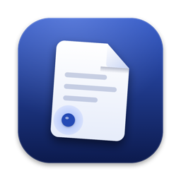
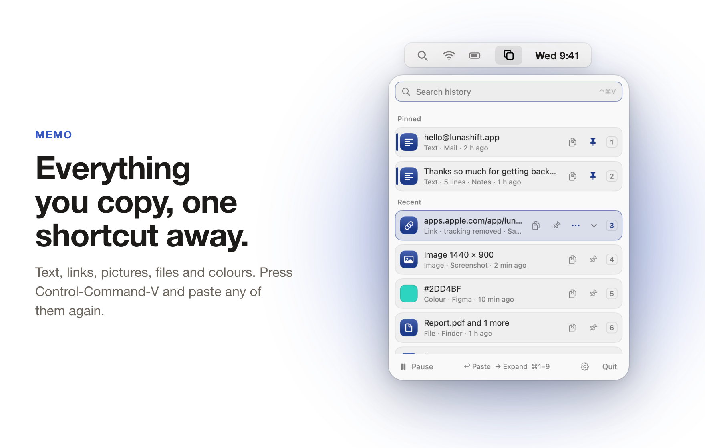
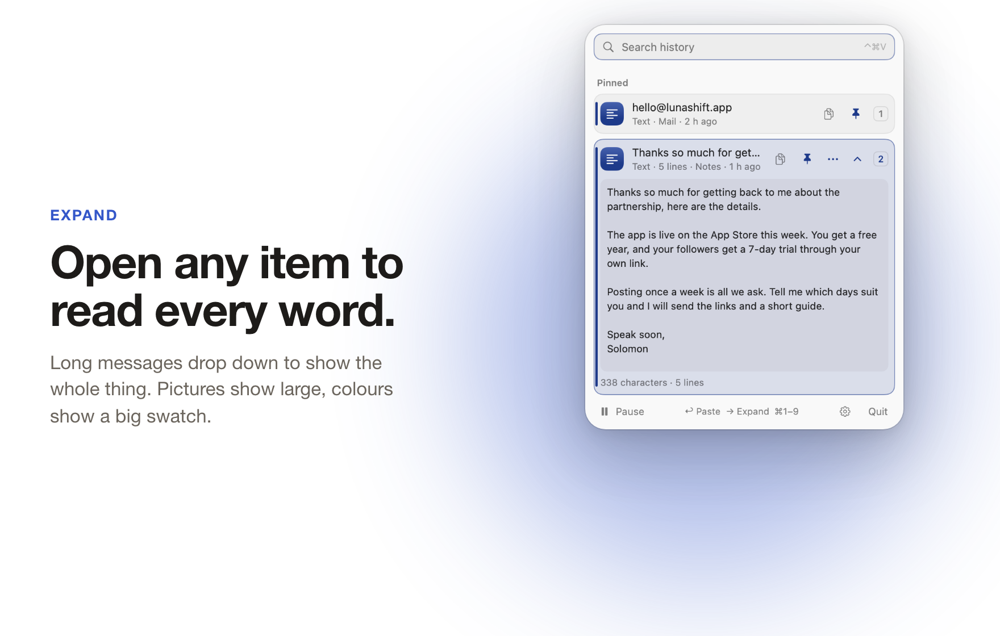
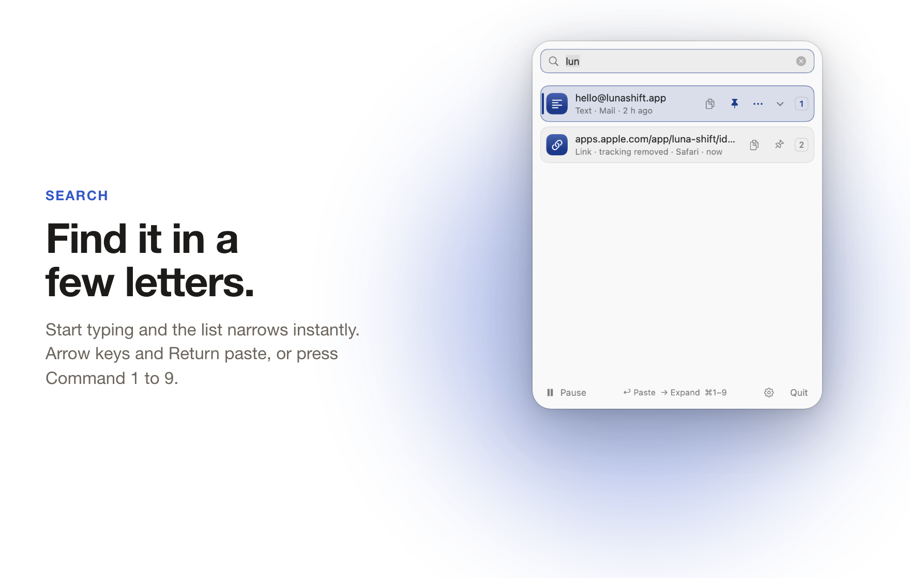
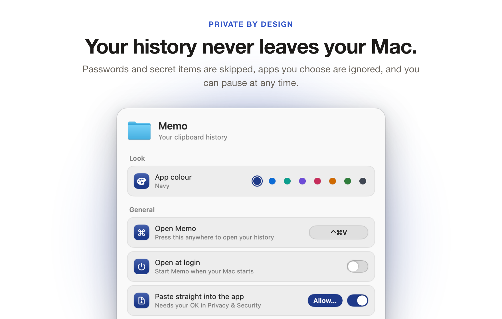
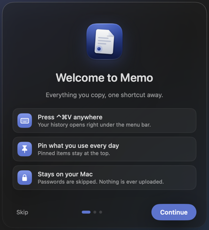
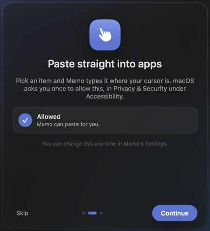
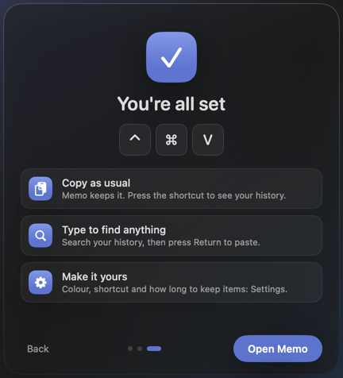

<div align="center">

<picture>
  <source media="(prefers-color-scheme: dark)" srcset="docs/img/icon-dark.png">
  
</picture>

# Memo

**Everything you copy, one shortcut away.**

<p>
  <a href="https://github.com/Solomon-69/Memo/releases/latest"></a>
  
  <a href="LICENSE"></a>
  
</p>

<p>
  <a href="https://github.com/Solomon-69/Memo/releases/latest/download/Memo-mac.zip"><b>Download for Mac</b></a>
  &nbsp;&middot;&nbsp;
  <a href="#install">Install</a>
  &nbsp;&middot;&nbsp;
  <a href="#privacy">Privacy</a>
</p>

<br>

<picture>
  <source media="(prefers-color-scheme: dark)" srcset="docs/showcase/memo-1-dark.png">
  
</picture>

</div>

Memo is a clipboard history for the Mac menu bar. Everything you copy (text, links, pictures,
files and colours) is kept in a tidy list. Press <kbd>⌃</kbd> <kbd>⌘</kbd> <kbd>V</kbd>
anywhere, pick something and it is pasted straight back into the app you are using.

It is written from scratch, inspired by other Mac clipboard managers and built to fix the things people most often ask
such tools for. It is free, open source, and nothing you copy ever leaves your Mac.

## Contents

- [Features](#features)
- [Install](#install)
- [Usage and keyboard shortcuts](#usage-and-keyboard-shortcuts)
- [Settings](#settings)
- [Privacy](#privacy)
- [Memo for Windows](#memo-for-windows)
- [Requirements](#requirements)
- [Building from source](#building-from-source)
- [Licence](#licence)

## Features

Memo keeps your clipboard history close at hand, and keeps it to itself.

<picture>
  <source media="(prefers-color-scheme: dark)" srcset="docs/showcase/memo-2-dark.png">
  
</picture>

### Open any item to read every word

Every row, pinned or recent, drops down to show the whole thing. No more guessing which of five
similar messages is the right one.

- **Long text** shows in full, and you can select part of it. Very long text scrolls inside the row.
- **Pictures** show large, **files** list every file, and **colours** show a big swatch with the code.
- Hover and click the small arrow, or press <kbd>→</kbd> or <kbd>Space</kbd>. <kbd>←</kbd> or <kbd>Esc</kbd> closes it again.
- Moving up or down with a row open opens the next one, so you can read down the list.

<br>

<picture>
  <source media="(prefers-color-scheme: dark)" srcset="docs/showcase/memo-3-dark.png">
  
</picture>

### Find it in a few letters

Start typing as soon as the panel opens and the list narrows with every letter.

- <kbd>↑</kbd> <kbd>↓</kbd> and <kbd>Return</kbd> paste the selected item, or press <kbd>⌘</kbd> <kbd>1</kbd> to <kbd>9</kbd> for the first nine.
- <kbd>⌥</kbd> <kbd>Return</kbd> pastes as plain text, without any formatting.
- **Pin** what you paste every day with the pin button on each row (or <kbd>⌘</kbd> <kbd>P</kbd>). Pinned items stay at the top, marked with a coloured bar.
- **Copy** any item with the copy button on its row, without pasting it anywhere.
- Each row shows what it is, which app it came from and when.

<br>

<picture>
  <source media="(prefers-color-scheme: dark)" srcset="docs/showcase/memo-4-dark.png">
  
</picture>

### Your history never leaves your Mac

Memo has no account and no network access. Your history is a small database on your Mac, and
you decide what goes into it.

- **Skips passwords and secrets:** items copied from password managers, and items apps mark as hidden, are never saved.
- **Ignore apps** you choose, and **pause** recording at any time.
- **Clean links:** removes tracking bits like `utm_source` and `fbclid` from copied links.
- **Keeps itself tidy:** set how many days to keep, the most items to keep and a size limit. Pinned items always stay.

**Also:** eight app colours, open at login, light and dark mode, and a menu bar icon that shows a
small tick each time something is copied.

## Welcome window

<p align="center">
  
  
  
</p>

Version 1.1.1 has a new three-page welcome with a frosted glass panel. Each page plays its animation once. The download buttons give the last published build (1.1); the newest version is published when its builds are ready.

## Install

1. Download [Memo-mac.zip](https://github.com/Solomon-69/Memo/releases/latest/download/Memo-mac.zip) and double-click it.
2. Drag **Memo** into your **Applications** folder.
3. The first time, right-click Memo and choose **Open**, then **Open** again. (Memo isn't notarised by Apple yet, so macOS asks once.)
4. To paste straight into apps, Memo asks for **Accessibility** permission in System Settings > Privacy & Security. Without it, Memo copies the item and you press <kbd>⌘</kbd> <kbd>V</kbd> yourself.

## Usage and keyboard shortcuts

| Where | Keys |
| --- | --- |
| Open Memo from anywhere | <kbd>⌃</kbd> <kbd>⌘</kbd> <kbd>V</kbd> (change it in Settings) |
| Move and paste | <kbd>↑</kbd> <kbd>↓</kbd> then <kbd>Return</kbd> |
| Quick paste | <kbd>⌘</kbd> <kbd>1</kbd> to <kbd>9</kbd> |
| Paste as plain text | <kbd>⌥</kbd> <kbd>Return</kbd> |
| Paste as Markdown | <kbd>⌥</kbd> <kbd>⇧</kbd> <kbd>Return</kbd> |
| Expand or collapse a row | <kbd>→</kbd> or <kbd>Space</kbd>, and <kbd>←</kbd> or <kbd>Esc</kbd> |
| Pin or unpin | <kbd>⌘</kbd> <kbd>P</kbd> |
| Delete an item | <kbd>⌘</kbd> <kbd>⌫</kbd> |

## Settings

- **Look:** app colour.
- **General:** the shortcut that opens Memo, open at login, and paste straight into the app.
- **History:** how many days to keep, the most items to keep, and a size limit, plus how much space it uses.
- **Privacy:** skip passwords and secrets, clean links, pause recording, and apps to ignore.

## Privacy

Memo collects nothing and makes no network connections. Your history is stored only on your Mac,
in Memo's own folder in Application Support. Old items and files they leave behind are cleaned up
automatically, following your History settings.

## Memo for Windows

Memo also runs on Windows 10 and 11, as a native tray app (C# and .NET 8, no browser engine inside). It keeps the same
history of text, pictures and files, with pinning, search, delete and rows that open to show everything.

- **Open it:** press <kbd>Ctrl</kbd> <kbd>Shift</kbd> <kbd>V</kbd> anywhere, or click the clipboard icon in the tray. The panel opens just above the icon. Other shortcuts are in Settings, in case another app already uses this one.
- **Paste:** <kbd>Enter</kbd> or a click pastes into the app you came from (Memo presses <kbd>Ctrl</kbd> <kbd>V</kbd> for you; no special permission is needed). <kbd>Ctrl</kbd> <kbd>1</kbd> to <kbd>9</kbd> pastes the first nine.
- **Keys:** <kbd>Right</kbd> or <kbd>Space</kbd> opens a row, <kbd>Esc</kbd> closes it, <kbd>Ctrl</kbd> <kbd>P</kbd> pins, <kbd>Delete</kbd> removes.
- **Settings:** eight app colours, light, dark or follow Windows, shortcut, open at login, how long to keep things, skip passwords and secrets, clean links, pause, and apps to ignore.
- **Welcome screens** on the first start, like the Mac.
- **Private:** history lives in `%APPDATA%\Memo` and Memo makes no network connections.

Download `Memo-windows.zip` from the latest successful run of the **Windows test** workflow (Actions tab), unzip it and run `Memo.exe`.
The app is not code-signed yet, so Windows SmartScreen may ask once: choose **More info** then **Run anyway**.

**Build and test:** every push to `main` builds the app on a Windows machine and runs a self-test (`windows/ci/test.ps1`):
it copies text, links, colours, pictures, files and a secret onto the real clipboard, checks what Memo kept, then tries
pin, search, delete, saving, pasting back, the popup, Settings, the welcome window and the shortcut, in light and dark.
Screenshots are kept with the run. To build by hand on Windows: `dotnet publish windows/Memo.csproj -c Release`.

## Requirements

- macOS 14 Sonoma or later, on Apple silicon.
- Windows 10 or 11, 64-bit (see [Memo for Windows](#memo-for-windows)).

## Building from source

```bash
git clone https://github.com/Solomon-69/Memo.git && cd Memo && ./build.sh
```

`./build.sh` compiles Memo with `swiftc` (no Xcode project needed) and installs it to
`~/Applications`. `RELEASE=1 ./build.sh` leaves out the test hooks. Tests: `QA/test.sh`.
Screenshots of every screen, rendered off-screen in light and dark: `QA/snap.sh`.

## Licence

[MIT](LICENSE). Memo shares no code with other clipboard managers. See [THIRD_PARTY.md](THIRD_PARTY.md).

## Unsigned apps: how to open them, and how to check your download

These apps are not signed yet. Signing needs Apple's paid developer account (and a Windows code-signing certificate), which the project does not have yet. The apps are safe to use as far as the author knows, but your computer cannot prove who made them, so it warns you the first time.

- **Mac:** right-click the app, choose **Open**, then **Open** again. If there is no Open button, go to System Settings > Privacy & Security and click **Open Anyway**.
- **Windows:** if SmartScreen says "Windows protected your PC", click **More info**, then **Run anyway**.

To check that a download has not been changed, compare its SHA-256 fingerprint with the one in [CHECKSUMS.md](CHECKSUMS.md) (Mac: `shasum -a 256 <file>` in Terminal; Windows: `certutil -hashfile <file> SHA256`).

## Trademarks

Memo is an independent project, not affiliated with or endorsed by the makers of any other clipboard manager. All trademarks belong to their owners.
